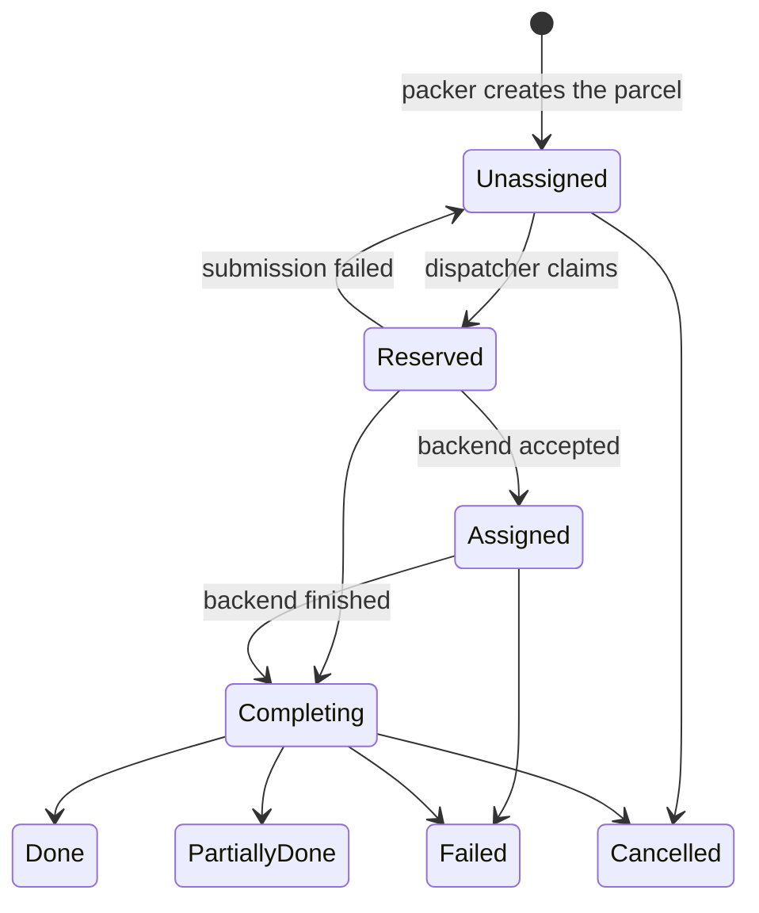
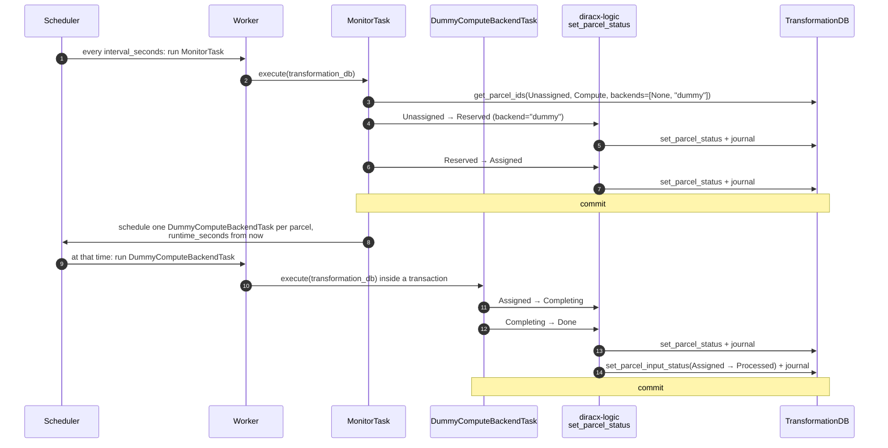

# Dummy Compute Backend

The Dummy Compute Backend pretends to execute the **parcels** of the
Transformation System. It gives every compute parcel a successful outcome
without running anything, so that the loop of feeder → packer → execution can
be exercised end to end, in a local or `diracx-charts` demo deployment, before
any real compute backend exists.

It is the Transformation System counterpart of the **Dummy Job Executor**
(`diracx-tasks/src/diracx/tasks/jobs/dummy_job_executor.py`), which does the
same for WMS jobs. This document covers both how it works and how the code
flows, from the periodic task down to the SQL it runs.

- [Background](#background)
- [From the Dummy Job Executor to the Dummy Compute Backend](#from-the-dummy-job-executor-to-the-dummy-compute-backend)
- [What it does, in one picture](#what-it-does-in-one-picture)
- [Where the code lives](#where-the-code-lives)
- [Code flow](#code-flow)
- [The database layer in detail](#the-database-layer-in-detail)
- [Concurrency and failure behaviour](#concurrency-and-failure-behaviour)
- [Configuration](#configuration)
- [Running it](#running-it)
- [Tests](#tests)
- [Limitations and next steps](#limitations-and-next-steps)

## Background

The vocabulary comes from the Transformation System ADRs in `docs/adr/`:

| Term                | Meaning                                                                                                     | ADR                    |
| ------------------- | ----------------------------------------------------------------------------------------------------------- | ---------------------- |
| **Transformation**  | Applies one operation to a pool of **inputs**, in units of parcels                                          | DX-ADR-002             |
| **Input**           | One unit of processable input, usually a file                                                               | DX-ADR-002, DX-ADR-004 |
| **Packer**          | Groups `Unassigned` inputs into parcels; the inputs become `Assigned`                                       | DX-ADR-006             |
| **Parcel**          | An immutable, non-retryable unit of dispatched work (a row of `Parcels`)                                    | DX-ADR-002, DX-ADR-004 |
| **Dispatcher**      | Claims `Unassigned` parcels and hands each one to a backend                                                 | DX-ADR-003             |
| **Compute backend** | Runs a compute parcel (as a job, a glidein, ...) and reports its outcome                                    | DX-ADR-003             |
| **Counter journal** | Signed deltas, written in the same transaction as each status change, from which per-status counts are read | DX-ADR-009             |

A parcel has its own state machine (DX-ADR-005), transcribed as
`PARCEL_TRANSITIONS` in `diracx-core/src/diracx/core/models/transformation.py`:



`Done`, `PartiallyDone`, `Failed` and `Cancelled` are final: a parcel is never
retried, its inputs are.

## From the Dummy Job Executor to the Dummy Compute Backend

The Dummy Job Executor reads jobs from the `JobDB` and walks them through the
*job* state machine. The Transformation System does not work with jobs: in
DX-ADR-003 a job is only what a parcel becomes on one particular backend
(`diracx-pilot`). So the new component reads **parcels** from the
`TransformationDB` and walks them through the **parcel** state machine. It is
named after what it is in the ADR vocabulary: a compute backend, recorded as
`Backend = "dummy"` on every parcel it takes.

|                 | Dummy Job Executor                                              | Dummy Compute Backend                                                                     |
| --------------- | --------------------------------------------------------------- | ----------------------------------------------------------------------------------------- |
| Database        | `JobDB`, `JobLoggingDB`, `TaskQueueDB`                          | `TransformationDB`                                                                        |
| Picks up        | `Received` jobs                                                 | `Unassigned` compute parcels with no backend, or the `dummy` backend                      |
| State walk      | `Received → Waiting → Matched → Running → Done`                 | `Unassigned → Reserved → Assigned → Completing → Done`                                    |
| Side effect     | none                                                            | the parcel's inputs go `Assigned → Processed`                                             |
| Status function | `diracx.logic.jobs.set_job_statuses`                            | `diracx.logic.transformations.set_parcel_status`                                          |
| Tasks           | `jobs:DummyJobExecutorMonitorTask`, `jobs:DummyJobExecutorTask` | `transformation:DummyComputeBackendMonitorTask`, `transformation:DummyComputeBackendTask` |
| Settings prefix | `DIRACX_TASKS_DUMMY_JOB_EXECUTOR_`                              | `DIRACX_TASKS_DUMMY_COMPUTE_BACKEND_`                                                     |

Both exist side by side. The Dummy Job Executor still serves the WMS demo, and
can be retired once user jobs are submitted as user parcels (DX-ADR-004), at
which point the Dummy Compute Backend runs them too.

## What it does, in one picture



## Where the code lives

The code follows the repository's layering: SQL in `diracx-db`, business rules
in `diracx-logic`, scheduling in `diracx-tasks`. Each layer only calls the one
below it.

| Layer    | File                                                                    | Contents                                                                                   |
| -------- | ----------------------------------------------------------------------- | ------------------------------------------------------------------------------------------ |
| Tasks    | `diracx-tasks/src/diracx/tasks/transformation/dummy_compute_backend.py` | `DummyComputeBackendSettings`, `DummyComputeBackendMonitorTask`, `DummyComputeBackendTask` |
| Tasks    | `diracx-tasks/src/diracx/tasks/plumbing/lock_registry.py`               | the `parcel` lock type                                                                     |
| Tasks    | `diracx-tasks/pyproject.toml`                                           | entry points in the `diracx.tasks.transformation` group                                    |
| Logic    | `diracx-logic/src/diracx/logic/transformations/parcels.py`              | `set_parcel_status`: checks the transition, applies the outcome to the inputs              |
| Database | `diracx-db/src/diracx/db/sql/transformation/db.py`                      | `get_parcel_ids`, `set_parcel_status`, `set_parcel_input_status`, `_journal_transition`    |
| Database | `diracx-db/src/diracx/db/sql/transformation/schema.py`                  | the `Parcels`, `Inputs`, `ParcelInputs` tables and the transformation counter (unchanged)  |
| Core     | `diracx-core/src/diracx/core/models/transformation.py`                  | `ParcelStatus`, `InputStatus`, `PARCEL_TRANSITIONS` (unchanged)                            |
| Core     | `diracx-core/src/diracx/core/exceptions.py`                             | `InvalidParcelTransitionError`                                                             |

## Code flow

### 1. Discovery and scheduling

`diracx-tasks/pyproject.toml` registers both tasks under the entry-point group
`diracx.tasks.transformation`:

```toml
[project.entry-points."diracx.tasks.transformation"]
DummyComputeBackendMonitorTask = "diracx.tasks.transformation:DummyComputeBackendMonitorTask"
DummyComputeBackendTask = "diracx.tasks.transformation:DummyComputeBackendTask"
```

`load_task_registry()` in `diracx/tasks/plumbing/factory.py` names each task
after the last part of its group, so they become
`transformation:DummyComputeBackendMonitorTask` and
`transformation:DummyComputeBackendTask`.

The monitor is a `PeriodicBaseTask`. Its class attributes decide whether, and
how often, the scheduler runs it:

```python
_enabled = _settings.enabled
default_schedule = IntervalSeconds(_settings.interval_seconds)
```

`_settings` is a `DummyComputeBackendSettings` built when the module is
imported, so the environment variables must be set before the scheduler and
the workers start. When `enabled` is false (the default) the scheduler never
runs the monitor, but it can still be run by hand (see
[Running it](#running-it)). As for every periodic task, the base class holds a
mutex named after the class while the monitor runs, so two runs never overlap.

### 2. Dependency injection

The worker inspects the signature of each task's `execute` and injects what it
asks for (`diracx/tasks/plumbing/depends.py`). A `BaseSQLDB` subclass is
normally injected **inside a transaction**: entered before `execute` runs,
committed if it returns, rolled back if it raises. The two tasks use the two
forms on purpose:

```python
# Monitor: manages its own transaction
async def execute(
    self, transformation_db: Annotated[TransformationDB, NoTransaction()]
) -> int: ...


# Completion task: one transaction around the whole of execute()
async def execute(self, transformation_db: TransformationDB) -> bool: ...
```

The monitor must **commit before it schedules** the completion tasks. If it
scheduled them inside its transaction, a worker could start one before the
commit, find the parcel still `Unassigned`, and do nothing, leaving the
parcel stuck in `Assigned` forever. (The Dummy Job Executor has exactly this
race.)

### 3. The monitor: `DummyComputeBackendMonitorTask.execute`

```text
async with transformation_db:                      # opens transaction
    parcel_ids = get_parcel_ids(
        Unassigned,
        kind=Compute,
        backends=[None, "dummy"],
        limit=max_parcels_per_cycle,
    )
    if none: return 0                              # rolls back: nothing written
    reserved  = set_parcel_status(parcel_ids, Unassigned → Reserved, backend="dummy")
    submitted = set_parcel_status(reserved,   Reserved   → Assigned)
                                                   # commit
for each parcel in submitted:
    DummyComputeBackendTask(parcel_id=str(parcel)).schedule(at_time=now + runtime_seconds)
return len(submitted)
```

Step by step:

1. **Select.** `get_parcel_ids` returns parcel identifiers in key order.
    `ParcelID` is a UUIDv7, so key order is creation order and the oldest
    parcels go first, which is the claiming order DX-ADR-003 prescribes. The
    filters keep the dummy to its own work:
    - `kind=Compute`: data parcels belong to data backends (DX-ADR-008);
    - `backends=[None, "dummy"]`: a parcel whose `Backend` the packer already
        set to something else is pinned there and left alone ("the dispatcher
        chooses, the packer constrains", DX-ADR-003);
    - `limit`: at most `max_parcels_per_cycle` per run, so one run never holds
        an unbounded number of row locks.
2. **Claim** (`Unassigned → Reserved`). This is the dispatcher's step. The move
    is a compare-and-set, so the returned `reserved` list contains only the
    parcels this run actually won. If another monitor claimed some of them
    first, they are simply missing from the list. `Backend` is set to `dummy`.
3. **Submit** (`Reserved → Assigned`). This is where a real backend would call
    `submit()`. For a real backend `Reserved` would be committed on its own
    first, to bound what a crash mid-submission can double-submit. The dummy's
    submit cannot fail and has no side effect, so both moves share one
    transaction.
4. **Commit**, by leaving the `async with` block.
5. **Schedule** one `DummyComputeBackendTask` per submitted parcel, delayed by
    `runtime_seconds`. The delay is the simulated run time; it also makes the
    `Assigned` state visible in the demo. The parcel identifier is passed as a
    `str` because task arguments are serialised with msgpack, which has no UUID
    type.

### 4. The completion: `DummyComputeBackendTask.execute`

```text
                                                   # worker opened the transaction
completing = set_parcel_status([parcel], Assigned → Completing)
if not completing:
    return False                                   # already done, or moved by someone else
set_parcel_status(completing, Completing → Done)   # also moves the inputs to Processed
return True
                                                   # worker commits
```

- `Assigned → Completing` stands for the backend reporting that the work has
    finished. `Completing` is where a real backend fetches its outcome, and where
    output files are registered in the catalogue (DX-ADR-003). The dummy
    produces no outputs, so there is nothing to register.
- `Completing → Done` records the outcome. Because `Done` is final, the logic
    layer also moves the parcel's inputs from `Assigned` to `Processed`, in the
    same transaction.
- Both moves are in **one** transaction. If anything fails, everything rolls
    back and the parcel is `Assigned` again, so the task's retry
    (`ExponentialBackoff(base_delay_seconds=10, max_retries=3)`) starts from a
    clean state. A parcel is never left half-way in `Completing`.
- If the parcel is no longer `Assigned`, the task does nothing and returns
    `False`. This happens when the task is run twice, or when an operator or a
    cancellation has moved the parcel in the meantime.
- `execution_locks` returns `MutexLock(PARCEL, parcel_id)`, so the worker
    never runs two completion tasks for the same parcel at once.

### 5. The logic layer: `diracx.logic.transformations.set_parcel_status`

Every status change goes through this one function, because DX-ADR-005 puts
the state machines in `diracx-logic` rather than in the database:

```text
set_parcel_status(parcel_ids, from_status, to_status, transformation_db, backend=None):
    if to_status not in PARCEL_TRANSITIONS[from_status]:
        raise InvalidParcelTransitionError
    if to_status is PartiallyDone:
        raise NotImplementedError                  # needs the recovery split
    moved = transformation_db.set_parcel_status(parcel_ids, from_status, to_status, backend)
    if moved and to_status is final:
        transformation_db.set_parcel_input_status(moved, Assigned → <outcome>)
    return moved
```

The parcel outcome reaches the inputs as DX-ADR-005 ("How the machines
connect") specifies:

| Parcel reaches  | Its `Assigned` inputs become | Notes                                                                     |
| --------------- | ---------------------------- | ------------------------------------------------------------------------- |
| `Done`          | `Processed`                  | each input was processed by exactly this parcel                           |
| `Failed`        | `Failed`, `ErrorCount + 1`   | the input failure hook (DX-ADR-006) later decides retry, give up or split |
| `Cancelled`     | `NotProcessed`               | no other parcel will claim them                                           |
| `PartiallyDone` | *not implemented*            | needs a born-`Done` recovery parcel and split children (DX-ADR-003)       |

The dummy only ever reaches `Done`, but the function is the general one: a
real backend, the dispatcher or a REST endpoint can use it for every
transition. `PartiallyDone` raises rather than half-working, because moving
the inputs without the recovery split would break the guarantee that every
input is processed by exactly one parcel.

## The database layer in detail

All three methods run on the connection of the transaction their caller
opened. None of them commits.

### `get_parcel_ids(status, *, kind=None, backends=None, limit=None)`

A plain indexed query on `Parcels`:

```sql
SELECT ParcelID FROM Parcels
 WHERE Status = :status
   AND Kind = :kind                              -- if kind is given
   AND (Backend IN (:names) OR Backend IS NULL)  -- if backends is given; IS NULL when None is in it
 ORDER BY ParcelID
 LIMIT :limit
```

The `(Kind, Status)` index on `Parcels` serves it.

### `set_parcel_status(parcel_ids, from_status, to_status, *, backend=None)`

A compare-and-set in three statements:

```sql
-- 1. Lock the rows that are really in from_status, in key order
SELECT ParcelID, TransformationID FROM Parcels
 WHERE ParcelID IN (:parcel_ids) AND Status = :from_status
 ORDER BY ParcelID
 FOR UPDATE;

-- 2. Move exactly those rows
UPDATE Parcels
   SET Status = :to_status
     , Backend = :backend          -- if backend is given
     , CompletedAt = utcnow()      -- if to_status is final (diracx SQL function)
 WHERE ParcelID IN (:locked) AND Status = :from_status;

-- 3. Journal the change, one pair of rows per transformation
INSERT INTO TransformationCounterJournal (TransformationID, Entity, Status, CountDelta)
VALUES (:t, 'Parcel', :from_status, -N), (:t, 'Parcel', :to_status, +N), ...;
```

- Parcels that are unknown, or not in `from_status`, are skipped without
    error. The method returns the identifiers it moved, and callers use that
    list: the monitor schedules only the parcels it won.
- Locking in key order makes concurrent writers take their locks in the same
    order, which keeps them from deadlocking.
- `N` is counted from the rows the transaction locked, never from what the
    caller believed, as DX-ADR-009 requires. A delta is therefore correct even
    when a concurrent writer moved some of the parcels first.
- User parcels have no `TransformationID` and no counter, so they are moved
    but not journalled.
- This method does **not** check that the transition is allowed. That is the
    logic layer's job.

### `set_parcel_input_status(parcel_ids, from_status, to_status, *, increment_error_count=False)`

The same pattern for the inputs of some parcels, found through `ParcelInputs`:

```sql
SELECT Inputs.TransformationID, Inputs.InputID
  FROM Inputs JOIN ParcelInputs USING (TransformationID, InputID)
 WHERE ParcelInputs.ParcelID IN (:parcel_ids) AND Inputs.Status = :from_status
 ORDER BY Inputs.TransformationID, Inputs.InputID
 FOR UPDATE;
-- then, per transformation:
UPDATE Inputs SET Status = :to_status [, ErrorCount = ErrorCount + 1]
 WHERE TransformationID = :t AND InputID IN (...) AND Status = :from_status;
-- then journal ('Input', from_status, -N) and ('Input', to_status, +N) per transformation
```

`ParcelInputs` keeps the full history: an input can appear under an old,
failed parcel and a new one. Filtering on `Inputs.Status = 'Assigned'` makes
sure only inputs still waiting on *this* outcome move. The updates are grouped
per transformation because the `Inputs` primary key starts with
`TransformationID`, so each update is a range on the clustered index.

### What the journal looks like

A parcel of three inputs going all the way from `Unassigned` to `Done`
journals these rows (`Completing` and the intermediate states net to zero):

| Entity | Status       | CountDelta (summed) |
| ------ | ------------ | ------------------- |
| Parcel | `Unassigned` | -1                  |
| Parcel | `Reserved`   | 0                   |
| Parcel | `Assigned`   | 0                   |
| Parcel | `Completing` | 0                   |
| Parcel | `Done`       | +1                  |
| Input  | `Assigned`   | -3                  |
| Input  | `Processed`  | +3                  |

## Concurrency and failure behaviour

| Situation                                                       | What happens                                                                                                                                   |
| --------------------------------------------------------------- | ---------------------------------------------------------------------------------------------------------------------------------------------- |
| Two monitors run at once (e.g. a manual `call` during a cycle)  | Both select the same parcels, but the claim is compare-and-set: each parcel is reserved by exactly one of them, and only that one schedules it |
| The monitor fails before its commit                             | Everything rolls back; the parcels are still `Unassigned` and the next cycle picks them up                                                     |
| The monitor dies after its commit, before scheduling every task | Those parcels stay `Assigned` with no completion task (see [Limitations](#limitations-and-next-steps))                                         |
| A completion task fails                                         | Its transaction rolls back to `Assigned`; the task is retried up to 3 times with exponential backoff                                           |
| A completion task runs twice                                    | The second run finds the parcel `Done`, moves nothing and returns `False`                                                                      |
| A parcel is moved by someone else before its completion task    | The completion task finds it no longer `Assigned` and leaves it alone                                                                          |
| Someone asks for a forbidden transition                         | `set_parcel_status` raises `InvalidParcelTransitionError` before touching the database                                                         |

## Configuration

`DummyComputeBackendSettings` reads these environment variables:

| Variable                                                   | Default | Meaning                                                     |
| ---------------------------------------------------------- | ------- | ----------------------------------------------------------- |
| `DIRACX_TASKS_DUMMY_COMPUTE_BACKEND_ENABLED`               | `false` | Let the scheduler run the monitor automatically             |
| `DIRACX_TASKS_DUMMY_COMPUTE_BACKEND_INTERVAL_SECONDS`      | `10`    | Time between two monitor runs (must be positive)            |
| `DIRACX_TASKS_DUMMY_COMPUTE_BACKEND_MAX_PARCELS_PER_CYCLE` | `1000`  | Parcels claimed per monitor run (must be positive)          |
| `DIRACX_TASKS_DUMMY_COMPUTE_BACKEND_RUNTIME_SECONDS`       | `5`     | Simulated run time before a parcel completes (zero or more) |

Both tasks also need the database URL `DIRACX_DB_URL_TRANSFORMATIONDB`, and the
task system needs `DIRACX_TASKS_REDIS_URL`.

## Running it

- **Locally**, `run_local.sh` sets `..._ENABLED=true` and
    `..._INTERVAL_SECONDS=10`.
- **In the `diracx-charts` demo**, `demo/values.tpl.yaml` sets the same two
    variables and lists `TransformationDB` under `diracx.sqlDbs.dbs`.
- **By hand**, with the `diracx-tasks` CLI:

```bash
# Run the monitor once: claim and submit the waiting parcels
diracx-tasks call transformation:DummyComputeBackendMonitorTask

# Complete one Assigned parcel now, without waiting for its scheduled task
diracx-tasks call transformation:DummyComputeBackendTask --args '["<parcel uuid>"]'
```

To see it work, a packer (or a test) must first create `Unassigned` compute
parcels, with their inputs `Assigned` and linked through `ParcelInputs`. After
one monitor cycle the parcels are `Assigned` on the `dummy` backend;
`runtime_seconds` later they are `Done` and their inputs `Processed`.

## Tests

| Test file                                              | What it covers                                                                                                 |
| ------------------------------------------------------ | -------------------------------------------------------------------------------------------------------------- |
| `diracx-db/tests/transformation/test_parcel_status.py` | filters and ordering, compare-and-set, journal rows, `CompletedAt`, user parcels, input moves and `ErrorCount` |
| `diracx-logic/tests/transformations/test_parcels.py`   | forbidden transitions, `PartiallyDone`, the input outcome of `Done`, `Failed` and `Cancelled`                  |
| `diracx-tasks/tests/test_dummy_compute_backend.py`     | scheduling controlled by the environment, settings validation, the parcel lock, a full `Unassigned → Done` run |

The full run in `test_dummy_compute_backend.py` uses a real SQLite
`TransformationDB`. It checks that a data parcel and a parcel pinned to
another backend are left alone, that a second monitor run claims nothing, and
that running the completion task again changes nothing.

```bash
pixi run pytest-diracx-db    tests/transformation
pixi run pytest-diracx-logic tests/transformations
pixi run pytest-diracx-tasks tests/test_dummy_compute_backend.py
```

## Limitations and next steps

- **It stands in for the dispatcher.** When the real dispatcher (DX-ADR-003)
    exists, the claim (`Unassigned → Reserved → Assigned`) moves there, and a
    backend keeps only its submit and its outcome reporting.
- **Every parcel succeeds and produces no output.** No `ParcelOutputs` rows are
    written, so a downstream transformation would receive nothing. That is
    enough for a workgraph of a single transformation; a longer workgraph would
    need fake outputs.
- **No backend identifier table.** DX-ADR-004 gives each backend a table of its
    own identifiers. The dummy has no external identifier, so it has none.
- **A crash window.** If the monitor dies after its commit but before it has
    scheduled every completion task, those parcels stay `Assigned`. Reconciling
    `Reserved` and `Assigned` parcels after a restart is an open issue of
    DX-ADR-003 for every backend, and the dummy does not attempt it.
- **`PartiallyDone` is not supported** until the recovery split exists.

To turn this into a real backend, keep the shape and replace the two dummy
steps: call the backend's `submit()` between committing `Reserved` and moving
to `Assigned`, record the identifier it returns in the backend's identifier
table, and replace the delayed completion task by the backend's own outcome
reporting (`poll`, `retrieve` or a callback) that ends in `Done`, `Failed` or
`PartiallyDone`.
