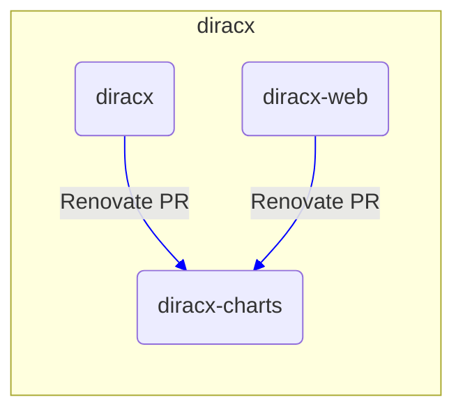

# Making and deploying releases

!!! warning "Version compatibility"

    DiracX should be upgraded before upgrading legacy DIRAC installations.

The versioning of `DIRAC`, `DIRACCommon`, `diracx`, `diracx-charts` and all the extensions are linked to one another.

## Dependencies between diracx, DIRAC and DIRACCommon

Both `DIRAC` and `diracx` depend on `DIRACCommon`. However, `DIRACCommon` is in the same repository as `DIRAC`, and versioned together. This means that if we need to move code from `DIRAC` to `DIRACCommon` such that it is usable by `diracx`, we need first a new release of `DIRAC` and `DIRACCommon` just moving the code, before being able to use it in `diracx`.

The releases of `DIRAC` and `DIRACCommon` are managed as they have always been, and are described in the `DIRAC` documentation

## Dependencies between diracx and diracx-charts

`diracx-charts` has a version number, as well as an `appversion`, which corresponds to the `diracx` version. This means that a new release of `diracx` requires a new `diracx-charts` release, which will update:

- the diracx-charts version
- the AppVersion
- the container versions

Renovate, configured in `diracx-charts`, detects the new `diracx` images and opens a pull request in `diracx-charts` with these changes. Once merged, it results in a new `diracx-charts` release.

## Dependencies between diracx, diracx-web and diracx-charts

The `diracx-web` version is only very loosely coupled with the `diracx` version.
A new `diracx-web` release leads, through the same Renovate pull request mechanism, to a new `diracx-charts` release updating:

- the chart version
- the container versions
- NOT the AppVersion

It does not bump the AppVersion because it refers to the `diracx` version, which is more relevant.



## diracx release

Releases are managed by `ReleasePlease`, which runs in the deployment workflow with the job's own `GITHUB_TOKEN`. It keeps the release pull request up to date and, once that is merged, creates a **draft** GitHub release.

!!! info "Why a draft release?"

    Only release managers may create tags, and no long-lived token is stored in the repository. A release manager publishes the draft: this creates the tag and triggers the jobs that publish to PyPI (through the `pypi` environment, approved by a second release manager) and to `ghcr.io`.

    Changes made with `GITHUB_TOKEN` trigger no workflows, so no CI runs on the release pull request. release-please updates that pull request after every merge to `main`, and each update removes its checks. To get checks, close and reopen it **right before merging**, then wait for them to pass.

    While the draft is not published, the deployment workflow skips `ReleasePlease`.

A new release creates:

- a [github release](https://github.com/DIRACGrid/diracx/releases)
- a [pypi release](https://pypi.org/project/diracx/)
- new [docker images](https://github.com/DIRACGrid/diracx/)

### Force version number

You can force a specific version number following the [doc](https://github.com/googleapis/release-please?tab=readme-ov-file#how-do-i-change-the-version-number)

```bash
git commit --allow-empty -m "chore: release 0.0.3" -m "Release-As: v0.0.3"
git push upstream HEAD:main
```

## diracx-web release

Releases are managed by `ReleasePlease`, which runs in the deployment workflow with the job's own `GITHUB_TOKEN`. A tag created with that token triggers no other workflow, so the release jobs run in the same workflow, after `ReleasePlease`.

A new release creates:

- a [github release](https://github.com/DIRACGrid/diracx-web/releases)
- an [npm release](https://www.npmjs.com/package/@dirac-grid/diracx-web-components) for `diracx-web-components`: CI stages the version, and a maintainer approves it on npm (2FA) before it is published
- new [docker images](https://github.com/DIRACGrid/diracx-web/)
- updated [Storybook documentation](https://diracgrid.github.io/diracx-web/) on GitHub Pages

## diracx-charts releases

Every commit in master triggers a new release. The releases are published on a [helm repo](https://charts.diracgrid.org/index.yaml)

The pull requests updating the chart for new `diracx` and `diracx-web` releases are opened by Renovate (see `renovate.json` in `diracx-charts`). Patch releases are marked for automerge, minor and major releases wait for a review. The `diracx-charts` ruleset requires an approving review on every pull request, so a maintainer still has to approve each of them before it merges.
