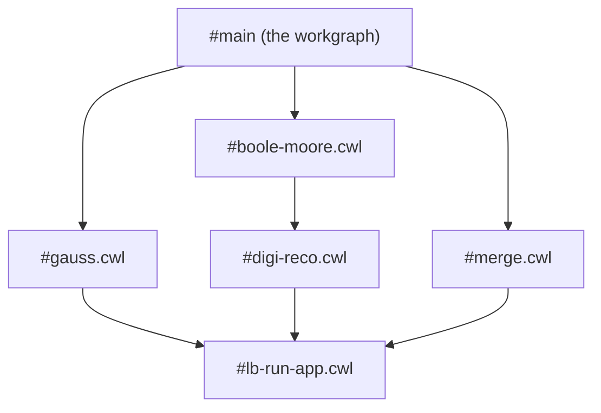

# CWL process identity

Every CWL process DiracX stores is keyed by a hash of its content
(DX-ADR-004, DX-ADR-007), computed by `diracx.core.cwl` from the document the
client submits.

## From files to identities

The client packs its files with `cwltool --pack` into one document: a
`$graph` of processes, each named after its file, where a step's `run` names
another entry. For the MCSimulation workgraph (issue #1080) that is six entries:

The services first check that the document is self-contained
(`check_self_contained`), so that nothing ever fetches anything on its behalf:

- no `$` key but the document's own `$graph` and `$namespaces`, and in a
    `$graph` document no other top-level key than `cwlVersion`: what
    `cwltool --pack` writes;
- no key or string starting with a prefix of `$namespaces` and a colon
    (`dirac:Transformation`, `edam:format_1930`), in whatever field: these are
    the only strings a binding can change, `cwltool --pack` writes them as full
    IRIs wherever CWL resolves them, and an identity does not cover what a
    prefix is bound to. A string such as an argument that only happens to
    start that way is refused too;
- every `$graph` entry has an id of its own;
- every `run` is an entry of the `$graph` or an inline body;
- `File` and `Directory` literals carry their `contents` or `listing`
    inline, never a `path` or `location`.

A `run` naming a stored process (`proc:sha256-<hex>`, the process-library
reference of DX-ADR-007) is therefore refused for now: the library is out of
scope for #1080. Once it lands, DiracX will resolve such references against
its own store before `check_self_contained`.

Then `decompose` hashes each process with `diracx.core.hashing.hash_json`, as
submitted, except that each step's `run` is replaced by the identity of the
process it runs (`proc:sha256-<hex>`), and that what is hashed is
`{"cwlVersion": "v1.2", "process": <body>}` with the body's own `cwlVersion`
dropped. Children are hashed before their
parents, so a parent's identity covers everything below it (a Merkle tree):

| Entry              | Identity        | Runs                      |
| ------------------ | --------------- | ------------------------- |
| `#lb-run-app.cwl`  | `80d85694a863…` | nothing                   |
| `#gauss.cwl`       | `e1e266130b5d…` | `80d85694a863…`           |
| `#digi-reco.cwl`   | `89aa5fb8d5f8…` | `80d85694a863…`           |
| `#boole-moore.cwl` | `31cd3f1f36f1…` | `89aa5fb8d5f8…`           |
| `#merge.cwl`       | `9d84d8c7268c…` | `80d85694a863…`           |
| `#main`            | `db52479ec2d7…` | the three transformations |

An edit to `lb-run-app.cwl` changes every identity in the table; an edit to
`merge.cwl` changes only its own and the workgraph's. An inline `run` body is
hashed the same way, so an identical body inline or by `#id` has one identity
(its `id` included: an inline copy without it, or with another, is another
process).

`subgraph(document, "#merge.cwl")` returns the entry and everything it runs,
as submitted: the document a stock runner executes for one transformation,
and which re-hashes to the same identities. A single process document, with
no `$graph`, is returned as it is.

## What is not normalised

The identity is the hash of what was submitted. The same files packed by
another cwltool version, with an edited `doc`, or under another file name get
other identities. That only costs a duplicate row, and it means DiracX never
rewrites a document: what is stored is what cwltool resolved, which is what
the user tested. The one exception is `cwlVersion`, hashed once for every
process whether its body repeats it or not; a body declaring another version
is refused.
