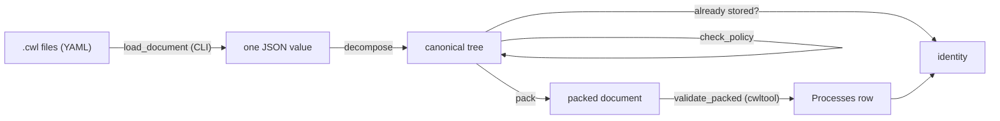

# CWL process store

Everything DiracX executes is described in CWL ([DX-ADR-007](../../adr/DX-ADR-007_cwl.md)).
When a workgraph is submitted, the process each transformation runs is stored
in the `Processes` table of the `TransformationDB`
([DX-ADR-004](../../adr/DX-ADR-004_schema.md)), keyed by a hash of its content.
This page explains how that identity is computed, how a process gets into the
store, and what a parcel reads back.

## One row per transformation

A transformation's process is usually a small `Workflow` around one or more
`CommandLineTool`s, possibly with nested sub-workflows. It is stored **flat**:
one `Processes` row holds the whole subgraph as a packed CWL document
(`$graph`), so materialising the payload a parcel runs is a single
primary-key read, and the row is exactly the document a stock CWL runner
executes.

The alternative described in the ADR, one row per CWL process with
`ProcessReferences` edges, was measured on a year of LHCb submissions and
gave no saving: almost all variation between jobs is inside the leaf tools,
so the tree deduplicates little, while costing more rows and a recursive query
at dispatch. The benchmark is in `benchmarks/process_store/`.

## Identity

A process is identified by the SHA-256 of its canonical form,
`diracx.core.cwl.canonical`, which is defined over the parsed document rather
than over any CWL library's output, so that it is deterministic, stable across
library upgrades and reproducible by any tool. In short (the module docstring
has the full rules, `CANONICAL_VERSION` numbers them):

- process `id`s, `$namespaces`, `dirac:` fields and hints, and `doc` and
    `label` where they are metadata are dropped: the identity is what runs,
    not what it is called, where it was loaded from, or how DiracX schedules
    it. Prefixes are first expanded to full URIs, so the identity covers what
    a prefix means, and names a user chose (an environment variable, a record
    field) are kept even when they are called `doc` or `label`;
- lists keyed by `id` or `class` are written as maps, and fully scoped
    identifiers are shortened against their scope, so formatting and absolute
    `file://` URIs do not matter;
- named types are written by short name, and a process may only use the
    named types it defines itself, so its identity covers their definitions;
- each nested `run` body is replaced by its own identity, so a workflow's
    identity covers its children's (a Merkle tree);
- the result is JSON with sorted keys and no whitespace.

The identity of a transformation is the root of that tree. The packed
document names every component by its own identity (`#sha256-<hex>`), so the
tree can be recovered from a stored row (`unpack`), and a component index or
per-component rows can be added later without changing any identity.

The hash is over the value, not the stored bytes: MySQL's `JSON` type
re-sorts keys and reformats numbers, so a row read back is re-canonicalised to
check it, which `diracx-db/tests/transformation/test_round_trip.py` verifies
on MySQL and MariaDB in CI.

## From files to a stored process

1. **Load** (`diracx.cli.cwl.load_document`, in the CLI): read the document
    as YAML 1.2 and inline every step's `run` path, `$import`, `$include` and
    `#fragment`, refusing cycles, deep nesting and oversized files. References
    to stored processes (`proc:sha256-<hex>`) are kept. YAML stays in the
    CLI: services only receive the resolved JSON. They refuse any `$import`,
    `$include` or other directive left in it, and cwltool never reads
    anything but the packed document.
2. **Canonicalise** (`decompose`): compute the tree and its identities.
    Only CWL v1.2 is accepted; older documents are refused with a request to
    run `cwl-upgrader`, since upgrading on the server would change what the
    user tested.
3. **Policy** (`check_policy`): requirements outside an allow-list that every
    backend can honour are refused, `dirac:` requirements included. So are
    abstract `Operation`s, which no runner can execute, and processes larger
    than 256 kB, whose content belongs in a sandbox or `File` input. Hints are
    not restricted.
4. **Hash first**: a process already in the store was validated when it was
    stored, so resubmitting it costs a lookup.
5. **Validate** (`diracx.logic.transformation.validation.validate_packed`):
    cwltool loads the packed document, checking it against the CWL schema and
    running its static checker on how step inputs are wired. Validating the
    packed document validates exactly what parcels will run.
6. **Store**: `INSERT IGNORE`, so concurrent submissions of the same process
    are safe.

A `run` may reference a stored process by identity, provided it is the root
of a stored row; its body is inlined into the new row.

## Replacing a transformation's process (operators only)

A stored process never changes: its key is its hash. What an operator can
change, for a hotfix such as a new software version, is which process a
transformation runs:
`diracx.logic.transformation.processes.replace_transformation_process`.
End users cannot: it needs the `ProductionManagement` or `Operator`
property, and the submission API offers no such change.

It refuses unless the transformation is `Paused` (its row is locked for the
change), a reason is given, the replacement passes the same policy and
cwltool validation as any submission, and the replacement keeps the
interface (input and output names and types, named types compared by
definition) of the process it replaces,
because the feeder, the packer, the declared outputs and downstream edges
depend on it. A different interface is a new transformation.

It then, in the caller's transaction:

1. points `ComputeTransformations.ProcessID` at the replacement, so new
    parcels run it;
2. repoints the transformation's `Unassigned` parcels, which no backend has
    seen yet;
3. records `ProcessReplaced` in `TransformationLog`, with both identities,
    the number of parcels repointed, the operator and the reason.

From `Reserved` on, a parcel keeps the process it was created with. This is
why `ComputeParcels.ProcessID` must stay a column of every compute parcel,
rather than being derived from the transformation: once a transformation's
process can change, a parcel's own copy is the only record of what it ran,
and "which parcels ran the hotfix" is a query on it.

DX-ADR-004 states that a transformation's `ProcessID` is frozen once it has
parcels, and DX-ADR-005 that a wrong configuration is cancelled and
resubmitted. Both still hold for owners; this operation is the operator's
exception to them.

## Not yet covered

- per-component rows, lineage ("which transformations contain this tool") and
    references to arbitrary components;
- `ProcessRegistry` names and versions, garbage collection, and VO visibility
    of stored bodies;
- pinning mutable references inside bodies, such as container tags;
- recording `CANONICAL_VERSION` per row.
